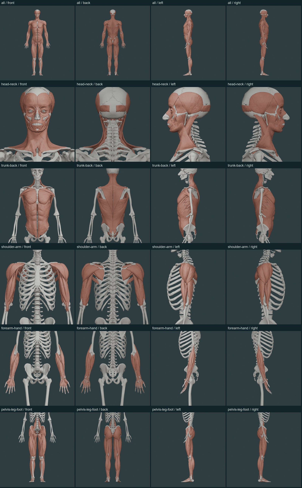

# Muscle views and delivered-model review

**The forearm display bug is corrected. The muscle atlas is still incomplete.** This review separates missing display context, missing named anatomy and anatomy that requires further validation. The current promotional video demonstrates the interface; further video production is on hold for muscle work.

## The humerus problem

The upper-arm bone view includes the humerus, radius and ulna, but the muscle toggle previously loaded only `shoulder-arm`. Its 15 muscle parts per side exclude the forearm file. The forearms therefore appeared bare despite their muscles being present in the assets.

Humerus and forearm views now load **both upper-limb files**, preserving the current camera and side. The composite contains 43 selectable structures / 54 parts per side, including the hand groups. All 20 usual forearm muscle names resolve on both sides: pronator teres, flexor carpi radialis, palmaris longus, flexor carpi ulnaris, flexor digitorum superficialis, flexor digitorum profundus, flexor pollicis longus, pronator quadratus, brachioradialis, extensor carpi radialis longus/brevis, extensor digitorum, extensor digiti minimi, extensor carpi ulnaris, anconeus, supinator, abductor pollicis longus, extensor pollicis brevis/longus and extensor indicis. This is named coverage, not independent certification of each attachment.

The elbow/forearm relationships were compared with [OpenStax §11.5](https://openstax.org/books/anatomy-and-physiology-2e/pages/11-5-muscles-of-the-pectoral-girdle-and-upper-limbs). Detailed regional muscle names primarily belong to Chapter 11; Chapter 10 teaches muscle tissue and contraction.

Additional view corrections:

- Navigating in **Select: Bones** updates the muscle region and side without moving the camera a second time.
- Switching muscles off retains the latest bone view and selection reached through that navigation.
- Changing region, side or layer clears stale muscle-group/part selection. A name from the previous filter should not remain presented as the current visible target.
- Choosing a muscle region or side returns picking to Muscles. Layer filtering in bone-picking mode preserves the bone field notes.
- The Known gaps button displays the number of open reference checks.

## Component-by-component inspection

Blender 4.5 imported the **actual five compressed delivery files**, including the recovered hand/foot geometry. The review inspected all **685 components**: 681 active, comprising 474 muscle parts and 207 supporting components, plus four superseded objects intentionally hidden. Counts include sides, heads and serial/aggregate groups; they are not a count of distinct human muscles.

[Every component's record](MUSCLE-COMPONENT-REVIEW.csv) includes its identity, name, side, source, polygon/vertex counts, finite geometry check, bounds comparison, major connected islands, visibility disposition and anatomical review limitation. Every active muscle part is reachable in its own region and in the whole-body view with All layers selected. Left/right naming agrees with the delivered coordinates. Asset identities, contents and hashes match the manifest.

Hand lumbrical and dorsal-interosseous aggregates have four major mesh islands per side; foot dorsal/plantar interosseous aggregates have four/three. Recovered palmar interossei and foot lumbricals retain their individual named members. Mesh islands can also arise from seams, fragments and tendon slips, so their count is a topology diagnostic rather than proof of a complete anatomical group.

All muscle bounds are within 0.375 mm of the manifest bounds. That measures **export consistency**, not human anatomical accuracy. Two supporting fascia surfaces—the left and right medial intermuscular septa of the arm—differ from the original manifest extents by about 10.05 mm. They remain flagged for a source/simplification comparison. Their metadata was not silently changed to conceal the difference.

Whole-body and all five regional files were rendered from front, back, left and right for visual comparison. These are geographic file views; regional grouping does not establish that every muscle attaching to a displayed bone is included. For example, the pectoralis major and latissimus dorsi are assigned to the trunk/back file and are present in Whole body. Complete attachment-driven regional sets remain a separate review requirement.

The original geometry and model hashes are unchanged. No model editing was needed to restore the forearm muscles. Before inspection, hash-verified copies of all five muscle files, skeleton, course tissues and muscle manifest were saved in `M:/OsteonMuscleAudit/2026-11-04/backups/`. Full-resolution renders, raw reports and logs remain on M:.

## Remaining completeness findings

The existing 226-entry reference checklist was reconciled again. It contains 161 named matches, eight groups represented by components, **50 entries without a named mesh**, four not separately resolved, one partial model and two naming/attachment questions. The latter three categories total seven unresolved entries. Variants and sex-specific anatomy are tracked separately; the 50 entries must not all be called omissions from one typical specimen.

| Geographic region | Open reference checks |
| --- | ---: |
| Head and neck | 31 |
| Trunk and back | 10 |
| Pelvis, leg and foot | 14 |
| Shoulder and upper arm | 1 |
| Forearm and hand | 1 |

The forearm/hand open entry is the separately tracked pollical palmar-interosseous variant; the usual 20 forearm names are present. The shoulder/arm entry concerns the separately unresolved articularis cubiti. Major remaining findings elsewhere include auricular and middle-ear muscles, tongue and soft-palate muscles, small spinal groups and perineal/sex-specific anatomy. [All 226 entries and their individual dispositions](MUSCLE-REFERENCE-AUDIT.csv) · [All open names and anatomical concerns](MUSCLE-ACCURACY-AUDIT.md).

## Source recovery candidates

The existing BodyParts3D 4.3 source cache contains **13 original surfaces across seven open checks**: levator veli palatini, tensor veli palatini, musculus uvulae, salpingopharyngeus, vocalis, oblique arytenoid and semispinalis capitis. [Source names, IDs and hashes](MUSCLE-SOURCE-CANDIDATES.csv) are recorded individually.

These are recovery candidates, not newly verified additions. Earlier regional fitting reports show errors large enough to matter for small head/neck structures, including a palatine comparison with an approximately 8.26 mm 95th-percentile surface distance. A single global fit is insufficient to establish small-muscle attachments. The semispinalis candidate also needs comparison with the existing source's ambiguously named spinalis capitis to avoid duplicating tissue.

The next model phase should register and inspect the five absent-name candidates first, compare the partial oblique arytenoid with its original source, and resolve the spinalis/semispinalis identity. Each geometry change needs a fresh verified backup. Acceptance requires relevant bone/cartilage context, checks on structures excluded from the fit, anatomy-based comparison from multiple directions and correct individual selection. A downloaded name or a good-looking overview cannot substitute for those checks.

## Verification and limits

All **184 existing and new automated checks** pass. The new regression covers both sides of humerus, radius and ulna views against all 20 usual forearm names and checks that every active muscle part can appear in its region and Whole body. Browser checks cover the corrected layer and bone-view round trip. Read-only Blender inspection and 24 regional render views supplement those software checks.

The review does not certify every muscle's complete shape, tendon course, attachment area, innervation or action. Many source components still lack detailed attachment teaching. The atlas needs further anatomical model work before it can be described as a complete muscle system.

Reproduce the delivered-model inspection with `scripts/blender/audit_shipped_muscles.py`, supplying the repository path and an output directory on M:. Rendered anatomy retains the Z-Anatomy / BodyParts3D component licenses in [CREDITS.md](CREDITS.md).
