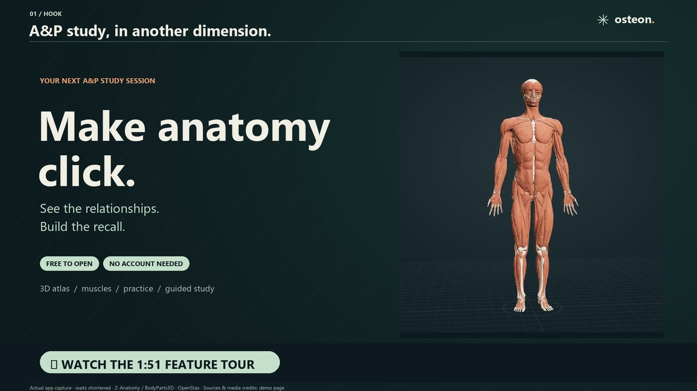
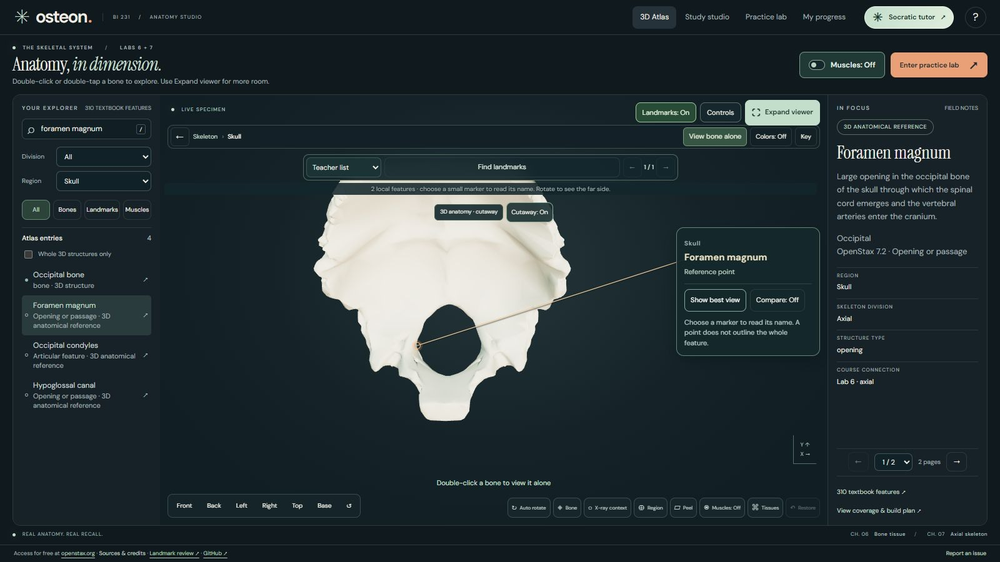
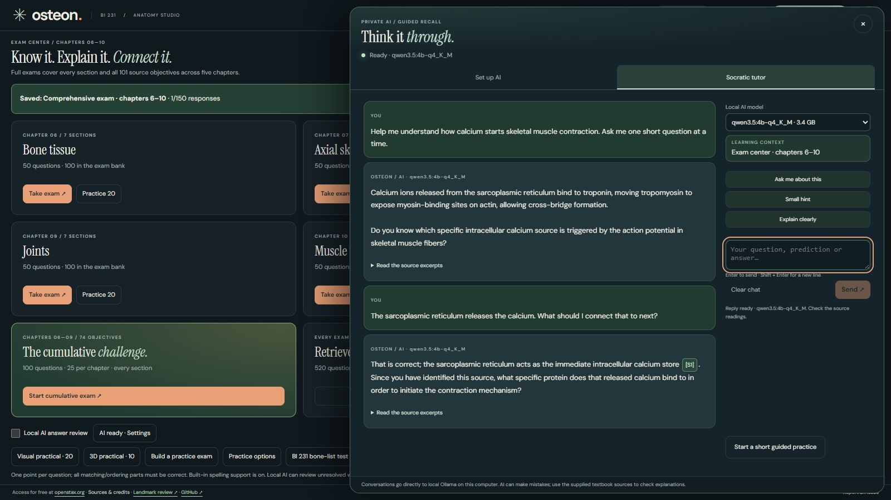
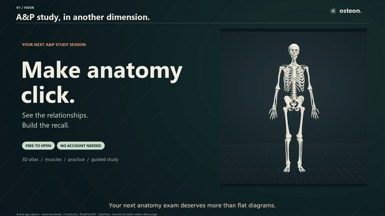

# Osteon

**A&P study, in another dimension.** Explore the skeleton and muscles, locate landmarks, and put your recall to work. Built around OpenStax Anatomy and Physiology 2e chapters 1–10, alongside the dedicated BI 231 bone-list test.

**Muscle review in progress:** the humerus/forearm layer now includes the forearm muscles correctly. The atlas still has missing and unresolved anatomy; [read the current review and individual component checks](MUSCLE-VIEW-REVIEW.md). Further promotional-video work is on hold for the muscle review.

**[Try Osteon free ↗](https://rorrimaesu.github.io/osteon-study/)** · **[Watch the 1:51 feature tour ▶](https://rorrimaesu.github.io/osteon-study/demo/#watch)** · [Download the 35-second vertical teaser](https://rorrimaesu.github.io/osteon-study/demo/osteon-promo-social.mp4) · [Get the new share kit](https://rorrimaesu.github.io/osteon-study/demo/osteon-promo-share-kit.zip)

**Built by an A&P student as he learns. Always growing with new content and improvements. Free to open in your browser; no account needed.**

- **Explore:** rotate the skeleton, double-click into a region, toggle muscles in your current view, and peel away covering surfaces.
- **Locate:** inspect labeled landmarks, openings, and teaching reconstructions.
- **Recall:** name numbered targets, check your answer, and return to missed material.
- **Connect:** study chapter notes, concept questions, glossary terms, and source readings on desktop or phone.
- **Think it through:** get one question at a time from a local Socratic tutor. Optional tutoring requires Ollama on your computer.

| Locate a clear landmark | Think it through |
| --- | --- |
|  |  |

See the nine-second animated preview

The new **111-second 1080p tour** shows 3D navigation, muscles and Peel, landmark controls, spelling-aware practice, OpenStax chapters 6–10, saved exams, a genuine local Socratic tutor exchange, progress and phone layouts. Both videos have warm female narration generated locally with **Qwen3-TTS**, an original **ACE-Step 1.5 XL Turbo** instrumental, and readable burned-in captions; separate caption files are included. [Watch, download, read the transcript, or copy a class-group post](https://rorrimaesu.github.io/osteon-study/demo/). [Production research, revisions and checks](demo/PROMO-PRODUCTION.md).

## Clearer practical targets

[Try the revised 16-target practical ↗](https://rorrimaesu.github.io/osteon-study/?clarity=1#practice). Small facets, openings and broad surfaces now have clearer views, surface patches or length traces. The drawer questions use real source bone meshes with a fixed femur, 90° flexion, direction arrows, replay and a neutral reference. All model edits were backed up first in Blender 4.5. [What changed, source evidence and limits](EXAM-LANDMARK-CLARITY.md).

The **Discs** control keeps spinal disc context separate from optional tissues and reports the current specimen count. Curvature practice uses the assembled spinal profile; single-bone isolation intentionally omits surrounding discs until Back. [Viewer fixes and verification](VIEWER-REVIEW.md).

## Landmarks directly on the model

Turn on **Landmarks** above the 3D viewer. Double-click a bone to see labels for its region, then repeat to study one bone. Small hollow markers keep the model clear. Select a marker to read one full name in a separate focus card. **Show best view** opens its authored study view; **Compare** deliberately adds up to three names on desktop or two on a phone. Local groups and marker pages keep related features together; **Find landmarks** searches the complete collection. **Teacher list** covers the required features; **All anatomy** adds the wider textbook collection and bone microanatomy. Switching Landmarks off hides annotations without changing tissues or the camera. Identification questions automatically conceal study labels.

The review reconciles all **177 teacher-list entries**: 59 direct bone entries and 118 integrated landmark/tissue/reference entries. Existing spatial practice remains 173 entries, with two source-recall items and two movement tests. Ligaments, discs, arteries and joint tissues now remain with their anatomical region when zoomed in. [Full in-view coverage checklist](ATLAS-LANDMARK-COVERAGE.csv).

Fontanelles open a **locally bundled, rotatable UCSF fetal-skull scan**, with superior, posterior and left/right developmental site guides plus the labeled newborn comparison. Some sites are narrowed or closed in the specimen, so the guides do not assert six open gaps. The ethmoidal air-cell region is also available, but individual drainage ostia remain unverified. Both limitations stay explicit and excluded from exact spatial scoring. [Model credits and separate specimen license](CREDITS.md).

## Chapters 1–5 foundations

- [Study Studio](https://rorrimaesu.github.io/osteon-study/#study) brings the earlier learning apps into the same chapter library, with a full source reader, a guided lesson and scored practice for every section. Every section also has a visual activity. Open **Explore → Full view** to use the controls alongside the larger diagram. Source-based landmark views are available under **Locate structures**. The coverage audit maps 61 sections and 200 source objectives to the exam bank, and the reader includes 402 chapter pages.
- Chapters 1–2 combine the original body worksheets, interactive cutting planes, organ systems, chemistry activities and the 239-question trainer.
- Chapters 3–4 include hands-on cell activities, a captioned protein-synthesis animation, tissue figure tours and textbook micrograph identification.
- Chapter 5 uses the original Lamina skin diagram with direct visual targets, skin lessons and written-response rubrics.
- [Fracture Lab in §6.5](https://rorrimaesu.github.io/osteon-study/#lesson-6.5) compares eight fracture patterns and skin-status categories, walks through four repair stages, and offers 252 scored prompts plus 84 written rubrics.
- [Practice Lab](https://rorrimaesu.github.io/osteon-study/#exam-center) offers individual 50-question exams, mixed exams for Chapters 1–2 and 3–5, and a 300-question comprehensive exam across Chapters 1–10. The existing skeletal exam options are also available.

My Progress can preview and merge matching earlier Cell Studio, Tissue Studio, Lamina and Fracture Lab scores. It can also recover missed trainer cards and read Lamina or Fracture Lab JSON exports. Drafts and notes from the original apps can still be opened there. The local tutor uses Osteon’s lesson notes for Chapters 1–10 and links to the relevant textbook pages.

## Chapters 6–9 exam preparation

[Open the exam center ↗](https://rorrimaesu.github.io/osteon-study/?exam=1#practice) · [Teaching plan](CHAPTERS-6-9-PLAN.md) · [Objective coverage](CURRICULUM-COVERAGE.csv)

Study all **24 sections** with complete source readings and figures, guided notes, comparisons, closed-book retrieval and application. All 99 source figures have direct lesson links. New relationship labs and a movement explorer connect the chapter 8/9 notes with practice. The four **50-question chapter exams** cover every section in their chapter. The **100-question cumulative exam** includes 25 questions per chapter and samples all **74 source objectives**. Short 20-question practice is explicitly a sample; full-bank review contains all 400 exam-bank questions (100 per chapter).

Multiple choice, typed recall, anatomical schematic identification, matching and ordering use explicit answer keys and source-linked explanations. Full exams delay feedback until submission. Save a draft, flag questions, edit answers and review section/objective results. Source or tutor assistance stays attached after reload and is separated from independently correct answers. One point per question; all matching/ordering parts must be correct. Export completed reports; up to 20 sessions remain in this browser. Earlier question versions are retained for export rather than silently regraded. These are original study questions, not the instructor’s exam.

## Spelling support and optional local AI

New chapter/section exams and full-bank review accept clear spelling errors and appropriate equivalent wording **without Ollama**. Results separate spelling notes, equivalent wording, concept gaps and unresolved meaning. Pending answers show a possible score range and are not recorded as confirmed anatomy failures. Formal anatomical terms, sides, counts and different structures keep their distinctions.

After a test, choose **Practice spellings** to compare changed letters, hide the term and try it from memory. Due words also appear in the Exam center. This practice never edits your submitted response or changes your exam score.

Turn on **Local AI answer review** and use **Set up local AI** for the shared tutor/reviewer setup. New exams use it for unresolved wording; failed or uncertain reviews stay pending and can be retried from the fixed original response later. The BI 231 test, 3D and supplementary practice retain their existing optional AI workflow. Original responses, strict key results and review evidence stay in reports. Earlier exam scores retain their original rules. [How grading works and its limits](ANSWER-REVIEW.md).

## Your BI 231 bone-list test

[Open the dedicated test ↗](https://rorrimaesu.github.io/osteon-study/?lablist=1#practice) · [Document reconciliation](BONE-LIST-REVIEW.md) · [Download the checklist](BONE-LIST-CHECKLIST.csv)

The supplied Lab 6/7 document is reconciled to all **177 original study entries**. A full run has **182 questions**: 173 3D identification targets, two drawer movement questions, two source-recall questions and five vertebral count blanks. Choose the entire document, Lab 6, Lab 7 bone test, or the four shoulder muscle-test ligaments. Named items repeated across the two labs are tested once in the full run.

Search the original wording beside the standard anatomical names, open an item's study view, save and continue a test, retry missed/assisted items, and export the results. Hints remain recorded after reload. Fontanelles and the grouped ethmoid drainage item retain their spatial accuracy holds and use explicitly labeled source recall. They are included in the test without claiming verified 3D opening locations.

Read [the implementation and learning plan](PLAN.md) and [release notes](CHANGELOG.md).

The atlas combines two-stage double-click navigation, colors in focused regions, and the completed [310-feature textbook inventory](LANDMARKS.md). Open the landmark bank from the atlas or Practice lab. Supported references and labeled teaching reconstructions provide spatial practice; eight textbook features remain excluded from scored locating. See the [current per-entry accuracy review](accuracy.html) and [source inventory](LANDMARKS.csv).

Read [the responsive workspace plan](RESPONSIVE-PLAN.md) for the desktop and mobile layout review. Desktop widths from 1000 pixels use a viewport-sized application with Previous / Next content pages, including the atlas lists, lessons, reading text and tutor history. Local AI setup uses a guided flow with a pinned next action instead of content pages. Phones and narrower tablets use Specimen / Browse / Details atlas controls and natural vertical reading. Search, answer drafts and progress are preserved when the layout changes.

Use **Expand viewer** on the model to fill the browser window on any screen. **Full screen** can also hide browser chrome when supported; **Exit expanded view** or Escape returns to the workspace. In practice, **Back to question** restores the existing question and typed draft. Laptop layouts give more height to the canvas and put selected-structure information behind **Details**; large desktops keep both side panels. **Controls** explains double-click/double-tap navigation, rotation, zoom and pan. Selecting a bone also offers an explicit **Zoom to region** action.

This is a static GitHub Pages site. No server account is required. Study progress stays in the browser. The original course documents and personal file paths are not published.

## Development

Serve this folder with any static HTTP server. Direct file opening is unsupported because the 3D asset must be fetched over HTTP. Runtime libraries and the model are bundled with the site. Source modules live in `src/`; `app.js` is the bundled browser entry point. For changes, use Node.js 22+ and run `npm ci`, `npm test`, `npm run audit`, then `npm run audit:lab-list`, `npm run audit:curriculum` and `npm run build`. Commit the rebuilt app.js before pushing to main; GitHub Pages publishes the repository root.

Model and content credits are maintained in CREDITS.md. See PLAN.md for the educational coverage and representation policy.

## Complete course release

- All 177 BI 231 lab IDs are preserved. Supported targets have locating/identification exercises; unresolved anatomy uses source study and recall while spatial grading is withheld. See the [current accuracy review](accuracy.html).
- Adult skeleton, 81 course tissue objects, additional anatomical detail, and labeled teaching reconstructions. Scene objects include bones, cartilage, teeth, ligaments, discs, sinus volumes, and vertebral arteries; mesh counts are not a biological bone count.
- Full source reader: all 172 pages of chapters 6–9, plus eight supplemental reference pages; 180 page images with searchable extracted text. Source pages load on demand.
- 24 teaching sections, all 74 source learning objectives, 504 authored questions (400 mixed-format exam items plus 104 supplementary questions), 544 textbook glossary definitions and 19 guided activities.
- Locate and name practice, a systematic unpracticed-first course pass, region/session controls, missed-item retries, local review scheduling, score separation and progress backup/restore.

**My progress** now maps all 177 lab targets by their latest scored attempt and starts a focused ten-target identification session or ten-question chapter session. Missed or assisted items come first, followed by untried items. Full-course identification clears atlas filters. Lesson cards show their question evidence separately from reading status. Self-rated recall updates card scheduling but does not clear a scored retrieval gap; neither a correct latest answer nor a repeated answer after 24 hours is a guarantee of mastery.

Due-card counts match the decks they open. The Practice menu scopes lab recall to its division and region; chapter recall covers all four chapters. Progress offers course-wide lab and chapter review decks regardless of the current atlas filters.

Landmark pins identify reference locations; they do not segment complete ridges, surfaces or boundaries. Only the anatomical endpoints of reliable source annotation leaders are used. Source textbook figures remain available for comparison; unresolved features use explicit source guidance. Fontanelles combine a native fetal-skull site guide with the newborn illustration. Drawer tests assess movement and ligament restraint. A parent-bone highlight never grades as locating a landmark.

The course list and chapter readings are covered in full. The finite question bank supplements those readings; it cannot guarantee every possible examination question. The anatomy is a single reference specimen and has not undergone independent instructor/anatomist validation. See QA.md for evidence and practical limits.

The site bundles its model and reading assets. Google Fonts is an optional external typography request with system fallbacks. No study progress is sent to a server. The original course document, full textbook PDF and personal paths are not published; licensed chapter page images and extracted text are included with attribution.

## Regional exploration, skeleton divisions and local tutoring

Double-click a bone from overview to open its region; double-click again to focus that bone alone. The actual side is retained. Back and the focus trail restore the previous view. Use the Region / Bone buttons or select from Browse and press Enter in the specimen as alternatives; touch supports double-tap. Escape in the specimen goes back. Single-clicking a bone selects it without an automatic camera jump.

Every focused region has bone colors, an optional key and a visible On / Off control. Paired counterparts share stable colors; colors also distinguish serial bones and neighboring anatomy. The choice survives reloads. Whole-skeleton, axial and appendicular overviews stay neutral, and scored practice turns colors off. All / Axial / Appendicular filters still apply to anatomy practice. Sacrum and coccyx remain axial; hip bones remain appendicular. Mixed pelvis targets appear under All.

Browse has All / Bones / Landmarks controls. Existing landmark pins and source illustrations remain explicitly identified; selecting an unsided reference target opens appropriate regional context. The 310-feature textbook bank remains separate from the original 177-item lab checklist. Fifty-two additional 3D reference anchors and full-size source diagrams expand spatial practice without claiming that every feature is separately modeled.

Use the **Socratic tutor** button for a local Ollama chat, installed-model selection, guided connection, explicit model downloads, optional hardware checks, and a Windows setup assistant. Existing installations skip unnecessary steps, and the tutor and answer reviewer share one model preference. See [the tutor guide](TUTOR.md) for first setup and honest browser limits. Tutor assistance is tracked separately from independent quiz accuracy.

## Current accuracy review

The review reconciles all **310 named textbook features** and **422 atlas/course entries**. All **177 original lab IDs** are preserved. Of the textbook features, **55 have applied corrections**, **247 retain supported source/morphology references**, and **8 remain study references excluded from scored locating**. These counts describe review dispositions, not clinical certification.

[Browse every review record](accuracy.html) · [Methods and limits](REVIEW.md)

Three missing openings now use direct Blender bone edits: the supraorbital foramen, stylomastoid foramen and nasolacrimal canal. Their labels identify actual sculpted rims; [construction evidence and limits](REVIEW.md) distinguish these edits from untouched native anatomy.

Complete study backups in My progress now include exam drafts and reports, the required bone-list test, review cards and spelling notes. Tutor chat and AI preferences are optional. Restore previews the contents and preserves earlier progress-only backup compatibility.

## Learning and exam update — November 4

Lessons now use **Orient, Understand, Explore, Retrieve and Apply**, with saved personal reasoning and a direct source-return path. A daily route combines due review, a weak section and varied retrieval. Exams offer visual/3D practicals, custom chapter or section weights, optional active-time goals and sparse confidence checks. Clear typos retain credit; uncertain wording stays pending and has a separate non-AI rehearsal. Detailed exam figures can be enlarged without revealing their masked names.

[Implementation tracker for the 70-point review](QUALITY-IMPLEMENTATION.md) records delivered features and outstanding expert, device and permission validation. Full backups now also include lesson drafts and question exposure. Automated coverage is not an independent anatomical or item-quality certification.

### Muscle tissue: Chapter 10

The study studio now includes all nine Chapter 10 sections, complete source reading, 85 key terms, 120 mixed-format questions and a 50-question chapter exam. A separate 150-question comprehensive exam spans Chapters 6–10 and all 101 source objectives; the original Chapters 6–9 exam remains available. Spelling support preserves intended answers while protecting distinct anatomical terms. Whole-body muscle anatomy is being released separately with explicit model review status.

### Optional 3D muscle layer

[Open the muscle atlas](https://rorrimaesu.github.io/osteon-study/?muscles=1#atlas). Use the large **Muscles: Off / On** toggle beside Practice Lab to add muscles to the view you are already looking at. It preserves the camera, matches the viewed region and side, and restores the bone selection when switched off. You can then choose a muscle region and side, search by name, or focus a whole muscle and inspect its heads. Labels and regional colors can be switched off. The five regional downloads total about 8.3 MB and display 474 muscle parts plus 207 supporting components. Z-Anatomy is supplemented by original BodyParts3D 4.3 surfaces. [Muscle coverage](MUSCLE-COVERAGE.csv) records every source component and its review status. This is source-aligned static reference anatomy; precise attachment footprints and movement remain excluded from spatial scoring. It does not certify that every anatomical variant or every human muscle is modeled.

### Muscle completeness review

**The current skeletal-muscle source is incomplete.** The [accuracy audit](MUSCLE-ACCURACY-AUDIT.md) tracks 226 reference entries: 50 have no named mesh, with further partial and unresolved anatomy. Variants and sex-specific entries are identified separately. All three usual palmar interossei and all four foot lumbricals are now individually selectable on each side, with origin, insertion and action notes. The four incomplete aggregate meshes are hidden and retained for rollback. Tensor fasciae latae is now correctly shown with supporting tissues off. Choose **Known gaps** in the muscle browser for the findings. The [full reference checklist](MUSCLE-REFERENCE-AUDIT.csv) distinguishes a named mesh from verified anatomy; no attachment is certified by this audit.

The revised LUMC Open3D hand supplies **palmaris brevis**, with an explicit mirrored left derivative. For recovered serial groups, open Details and choose **Study all group members** to compare their locations, then select a member without losing that group view.
