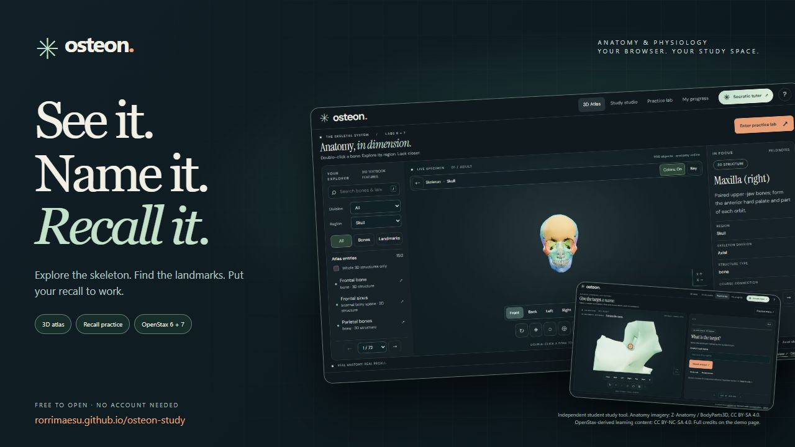
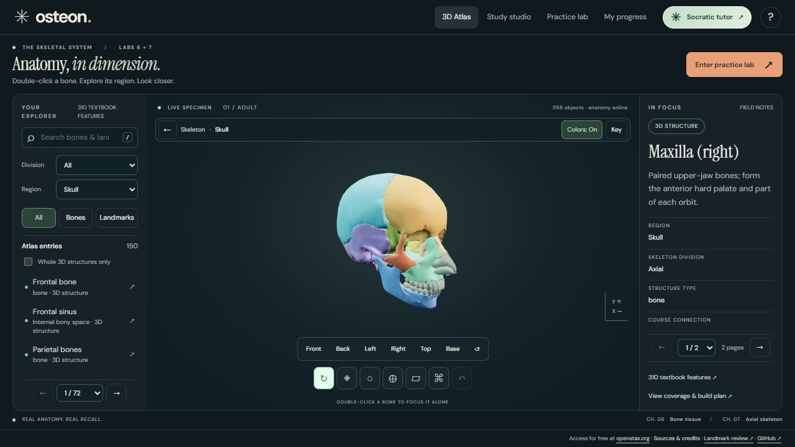
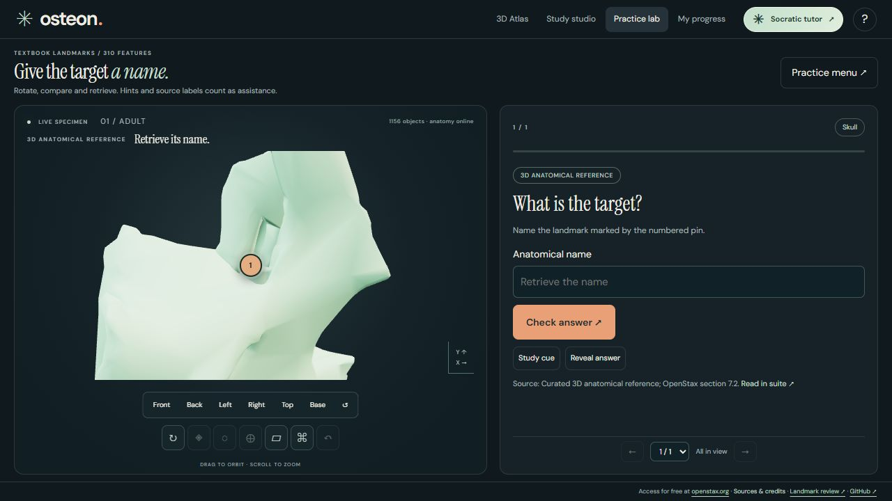
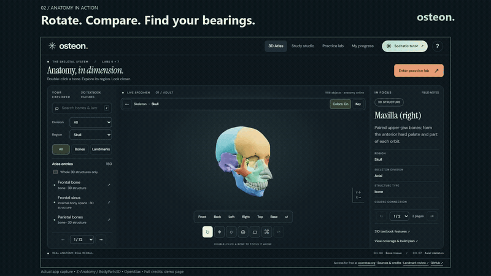

# Osteon

**A&P study, in another dimension.** Explore the skeleton, locate landmarks, and put your recall to work. Built around OpenStax Anatomy and Physiology 2e chapters 6 and 7, with the BI 231 lab list’s appendicular and joint extensions.

**[Try the app ↗](https://rorrimaesu.github.io/osteon-study/)** · **[Watch the 29-second demo ▶](https://rorrimaesu.github.io/osteon-study/demo/)** · [Download the vertical social video](https://rorrimaesu.github.io/osteon-study/demo/osteon-social.mp4) · [Get the complete share kit](https://rorrimaesu.github.io/osteon-study/demo/osteon-share-kit.zip)

- **Explore:** rotate the skeleton, double-click into a region, and compare bones with optional colors.
- **Locate:** inspect labeled landmarks, openings, and teaching reconstructions.
- **Recall:** name numbered targets, check your answer, and return to missed material.
- **Connect:** study chapter notes, concept questions, glossary terms, and source readings on desktop or phone.

| Explore relationships | Put recall to work |
| --- | --- |
|  |  |

See the nine-second animated preview

The videos use actual app interactions with captions and no music. [Screenshots, downloads, transcript, and class-group post copy](https://rorrimaesu.github.io/osteon-study/demo/) are ready to share. Free to open; no account needed.

Read [the implementation and learning plan](PLAN.md) and [release notes](CHANGELOG.md).

The atlas combines two-stage double-click navigation, colors in focused regions, and the completed [310-feature textbook inventory](LANDMARKS.md). Open the landmark bank from the atlas or Practice lab. Supported references and labeled teaching reconstructions provide spatial practice; eight textbook features remain excluded from scored locating. See the [current per-entry accuracy review](accuracy.html) and [source inventory](LANDMARKS.csv).

Read [the responsive workspace plan](RESPONSIVE-PLAN.md) for the desktop and mobile layout review. Desktop widths from 1000 pixels use a viewport-sized application with Previous / Next content pages, including the atlas lists, lessons, reading text and tutor history. Phones and narrower tablets use Specimen / Browse / Details atlas controls and natural vertical reading. Search, answer drafts and progress are preserved when the layout changes.

This is a static GitHub Pages site. No server account is required. Study progress stays in the browser. The original course documents and personal file paths are not published.

## Development

Serve this folder with any static HTTP server. Direct file opening is unsupported because the 3D asset must be fetched over HTTP. Runtime libraries and the model are bundled with the site. Source modules live in `src/`; `app.js` is the bundled browser entry point. For changes, use Node.js 22+ and run `npm ci`, `npm test`, `npm run audit`, then `npm run build`. Commit the rebuilt app.js before pushing to main; GitHub Pages publishes the repository root.

Model and content credits are maintained in CREDITS.md. See PLAN.md for the educational coverage and representation policy.

## Complete course release

- All 177 BI 231 lab IDs are preserved. Supported targets have locating/identification exercises; unresolved anatomy uses source study and recall while spatial grading is withheld. See the [current accuracy review](accuracy.html).
- Adult skeleton, 81 course tissue objects, additional anatomical detail, and labeled teaching reconstructions. Scene objects include bones, cartilage, teeth, ligaments, discs, sinus volumes, and vertebral arteries; mesh counts are not a biological bone count.
- Full source reader: every page of chapters 6 and 7, plus appendicular and selected joint readings; 144 page images with searchable extracted text. Source pages load on demand.
- Twelve teaching sections, 104 authored concept questions, 237 textbook glossary definitions and seven guided activities.
- Locate and name practice, a systematic unpracticed-first course pass, region/session controls, missed-item retries, local review scheduling, score separation and progress backup/restore.

**My progress** now maps all 177 lab targets by their latest scored attempt and starts a focused ten-target identification session or ten-question chapter session. Missed or assisted items come first, followed by untried items. Full-course identification clears atlas filters. Lesson cards show their question evidence separately from reading status. Self-rated recall updates card scheduling but does not clear a scored retrieval gap; neither a correct latest answer nor a repeated answer after 24 hours is a guarantee of mastery.

Due-card counts match the decks they open. The Practice menu scopes lab recall to its division and region; chapter recall keeps both chapters. Progress offers course-wide lab and chapter review decks regardless of the current atlas filters.

Landmark pins identify reference locations; they do not segment complete ridges, surfaces or boundaries. Only the anatomical endpoints of reliable source annotation leaders are used. Source textbook figures remain available for comparison; unresolved features use explicit source guidance. Fontanelles use a newborn illustration. Drawer tests assess movement and ligament restraint. A parent-bone highlight never grades as locating a landmark.

The course list and chapter readings are covered in full. The finite question bank supplements those readings; it cannot guarantee every possible examination question. The anatomy is a single reference specimen and has not undergone independent instructor/anatomist validation. See QA.md for evidence and practical limits.

The site bundles its model and reading assets. Google Fonts is an optional external typography request with system fallbacks. No study progress is sent to a server. The original course document, full textbook PDF and personal paths are not published; licensed chapter page images and extracted text are included with attribution.

## Regional exploration, skeleton divisions and local tutoring

Double-click a bone from overview to open its region; double-click again to focus that bone alone. The actual side is retained. Back and the focus trail restore the previous view. Use the Region / Bone buttons or select from Browse and press Enter in the specimen as alternatives; touch supports double-tap. Escape in the specimen goes back. Single-clicking a bone selects it without an automatic camera jump.

Every focused region has bone colors, an optional key and a visible On / Off control. Paired counterparts share stable colors; colors also distinguish serial bones and neighboring anatomy. The choice survives reloads. Whole-skeleton, axial and appendicular overviews stay neutral, and scored practice turns colors off. All / Axial / Appendicular filters still apply to anatomy practice. Sacrum and coccyx remain axial; hip bones remain appendicular. Mixed pelvis targets appear under All.

Browse has All / Bones / Landmarks controls. Existing landmark pins and source illustrations remain explicitly identified; selecting an unsided reference target opens appropriate regional context. The 310-feature textbook bank remains separate from the original 177-item lab checklist. Fifty-two additional 3D reference anchors and full-size source diagrams expand spatial practice without claiming that every feature is separately modeled.

Use the **Socratic tutor** button for a local Ollama chat, installed-model selection, guided connection, optional model downloads and hardware/fit checks. See [the tutor guide](TUTOR.md) for first setup and honest browser limits. Tutor assistance is tracked separately from independent quiz accuracy.

## Current accuracy review

The review reconciles all **310 named textbook features** and **422 atlas/course entries**. All **177 original lab IDs** are preserved. Of the textbook features, **55 have applied corrections**, **247 retain supported source/morphology references**, and **8 remain study references excluded from scored locating**. These counts describe review dispositions, not clinical certification.

[Browse every review record](accuracy.html) · [Methods and limits](REVIEW.md)

Three missing openings now use direct Blender bone edits: the supraorbital foramen, stylomastoid foramen and nasolacrimal canal. Their labels identify actual sculpted rims; [construction evidence and limits](REVIEW.md) distinguish these edits from untouched native anatomy.
